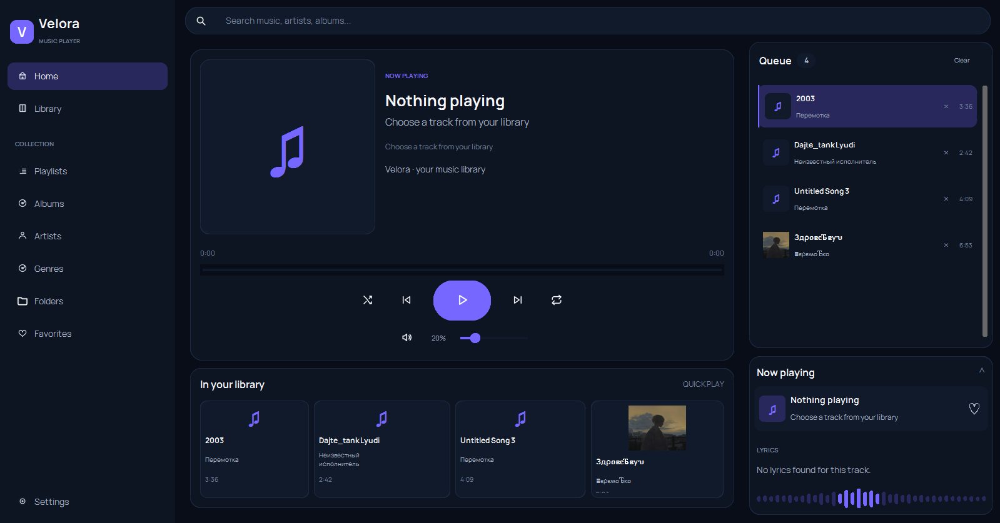

# Velora




A desktop music player for Windows, built with Python and CustomTkinter. Velora is for keeping a local music collection organised and easy to play, without needing to upload your files anywhere.

## Features

- Scan a folder and browse your local music library
- Sort music by track, album, artist, genre, or folder
- Play, pause, skip, seek, and adjust volume
- Shuffle tracks and repeat playback
- Keep a queue, save favorites, and create playlists
- Store library data and playlists locally with SQLite
- Show track artwork and a lyrics panel when information is available
- Package the app for Windows with PyInstaller

## Requirements

- Windows 10 or 11, 64-bit
- Python 3.11 or 3.12

Playback support can vary by audio format and the SDL_mixer codecs available in the installed `pygame-ce` build.

## Run locally

1. Install Python from [python.org](https://www.python.org/downloads/).
2. Open a terminal in the project folder.
3. Create a virtual environment and install the dependencies:

   ```bat
   py -3.12 -m venv .venv
   .venv\Scripts\activate
   python -m pip install --upgrade pip
   python -m pip install -r requirements.txt
   ```

4. Launch Velora:

   ```bat
   python app.py
   ```

If you have Python 3.11, replace `py -3.12` with `py -3.11`.

Choose your music folder in the app settings if the default location doesn't point to your collection. Velora indexes your files; it doesn't copy the music into the repository.

## Build a portable Windows version

On a 64-bit Windows machine with Python 3.11 or 3.12, run:

```bat
build_windows.bat
```

The script prepares the build environment, runs the tests, and packages the app with PyInstaller. If it succeeds, the app will be in `dist\Velora\` and the portable ZIP will be in the `dist` directory. Share the whole app folder or ZIP, not just the `.exe` file.

## Project layout

```text
assets/       Fonts and interface icons
config/       App settings and platform paths
core/         Library scanning and playback logic
database/     SQLite database and repositories
models/       Track, album, artist, and playlist models
services/     Audio, metadata, artwork, and analysis
tests/        Automated tests
ui/           Pages, components, and theme
app.py        Application entry point
```
